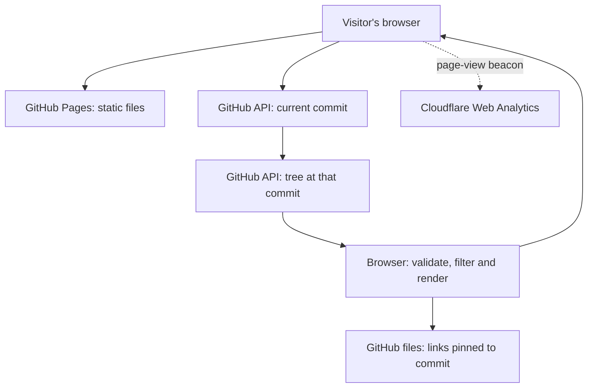

# Eduardo Seixas — AI Evaluation Portfolio

Personal portfolio for AI evaluation, data quality, science education, and applied research.

**Live site:** https://eseixas89.github.io/ai-evaluation-portfolio/


## Start here: final package

[FL-09 / FL-10 package index](capstone/README.md) links the available track artifacts, documentation, recording guide, retrospective draft, and outstanding final-review items. This is a prepared submission package, not a claim that the video, hours log, public post, FlyRank-hosted URL, or final sign-off is complete.

## Who this is for and what works

Recruiters and reviewers can inspect AI-evaluation case studies, project decisions, and the evidence behind them. The working **live evidence explorer** retrieves public repository metadata; it does not generate an AI answer or assess the correctness of the files it discovers. The separate **Research Scout** is a Python/Gemini research-agent implementation with its live model run still awaiting evidence.

## Reproduce the website

Requirements: Git and Python 3.10+ for the commands below; a current browser. No npm install, database, or private key is required to serve the site.

```bash
git clone https://github.com/Eseixas89/ai-evaluation-portfolio.git
cd ai-evaluation-portfolio
python -m http.server 8000
```

On Windows, use `py -m http.server 8000` if Python is installed as `py`. Open http://localhost:8000/ and then http://localhost:8000/live-evidence.html.

Usage example:

1. Leave **Research Scout** selected and choose **Load live evidence**.
2. Inspect the fetched time, snapshot commit, and source-file links.
3. Open a file: its URL should include the same full commit SHA.
4. Change to the workflow and load again within five minutes. The same-tab snapshot is reused.
5. Stop the server with Ctrl+C.

Internet access to the public GitHub API is required for the dynamic lookup. A successful load discovers available files; it does not mean the Scout ran successfully. Do not expect a fixed current commit or file count.

## Architecture sketch



The browser contains the selection logic and five-minute in-memory cache. GitHub's public API supplies the data; there is no custom backend. A 15-second timeout and readable failure states cover unavailable or incomplete responses. The original static-stack rationale predates this read-only integration; it remains the historical decision record.

The Research Scout follows a separate path: a Python CLI reads four public GitHub artifacts, sends context and the request to Gemini with Google Search grounding, and writes a Markdown brief. See [agent setup and usage](fl-07-agent/README.md). Loading the website does not start that process.

## Evidence, results and limitations

| Area | Recorded result | Practical limit |
|---|---|---|
| Evidence explorer | [Real public-browser run](make-it-do-something.md) and [hardening review](hardening-review.html) | File discovery is not content verification or a model run. Public API limits and network failures can stop the lookup. |
| Browser regression checks | 23 scenarios passed in the documented hardening run | API failure cases used fixtures; see [test methods](tests/README.md). |
| Physical phone | Owner confirmed navigation, CV download and demo on Samsung A15; fresh opening recorded in [launch evidence](launch-readiness.html) | Device-specific owner observation, not every device/browser. |
| Analytics | Owner screenshot shows 3 visits and 3 page views for the hostname over the displayed last-24-hours window | Not proof of three distinct people, organic traffic, or project-path totals. |
| Research Scout | Implementation, build log and seven evaluation cases are available | A successful live Gemini run, grounded report and recording are not recorded yet. Defined evaluations are not passed evaluations. |

Previous audit counts and timestamps describe their recorded snapshots. They are not an automatic certification of later revisions. The live website includes Cloudflare analytics; serving the same HTML locally retains the beacon. The local preview is not a controlled analytics experiment.

## AI involvement and ownership

ChatGPT/Codex assisted with planning, code, documentation, debugging and verification. Eduardo supplied the project context, constraints, peer feedback and physical-phone observations. The repository records what was actually checked and what remains unverified. The first-person retrospective and recording narration are AI-assisted drafts for Eduardo to review and personalize. No claim of unaided authorship, live-agent success, or FlyRank approval is made.

## Website files

- `index.html`: portfolio content, sections, navigation, and links.
- `styles.css`: colors, typography, layouts, mobile adjustments, print styles, and keyboard focus indicators.
- `favicon.svg`: the ES icon in the browser tab.
- `assets/Eduardo_Seixas_CV.pdf`: the supplied English CV, available to download.
- `dns-walkthrough.html`: infrastructure note covering DNS, CNAME, HTTPS, and this project's URL.
- `.nojekyll`: serves the files as a plain static website without Jekyll processing.
- `.github/workflows/pages.yml`: the existing deployment workflow for GitHub Pages.
- `SITE_GUIDE_PT.md`: a Portuguese explanation of how to understand, edit, and verify the site.

Existing project pages and `fl-07-agent/` remain separate evidence. The static site does not run the Python agent or need a private API key, database, or external font service. Core content remains readable without JavaScript; the live evidence explorer and Cloudflare Web Analytics use JavaScript.

## Preview locally

From the repository root, with Python installed:

```bash
python -m http.server 8000
```

Then visit http://localhost:8000. Stop the server with Ctrl+C.

## Updating

Edit content in `index.html` and presentation in `styles.css`. Committing to `main` triggers the existing Pages workflow. Check its completed deployment in the repository's Actions tab before verifying the public site.

## Contact and submission notes

The introductory-call button links to Eduardo's 30-minute Calendly event: https://calendly.com/eduardosseixas89/30min. Email is available separately.

The DNS learning note was prepared with AI assistance. Before submitting it as an assignment requiring your own words, review it, explain the process yourself, and revise its wording accordingly.

The supplied CV is unchanged. Add the live portfolio link to the CV and LinkedIn before marking that part of the assignment complete. Add the official FlyRank badge after it is issued following capstone approval.


## Live project evidence

[Try the working demo](https://eseixas89.github.io/ai-evaluation-portfolio/live-evidence.html). One dynamic feature retrieves the current public repository commit and its file tree from GitHub, then shows the selected project's evidence files with links pinned to that commit. No API key or model call is required. The page includes an English backend/data-flow explanation and a Portuguese explanation.

Implementation: `live-evidence.html`, `live-evidence.css`, `live-evidence.js`.


## Mobile, readability, and accessibility audit

[Public before/after fix log](https://eseixas89.github.io/ai-evaluation-portfolio/mobile-fix-log.html). Shared fixes live in `accessibility.css`. Browser checks cover phone, tablet, and desktop widths, with screenshots explicitly labelled as emulated. **The owner supplied a Samsung A15 screenshot and confirmed that menu navigation, CV download, and the live demonstration worked on that phone** and has a checklist in the log. See `mobile-audit-results.json` for the scoped machine-check summary.


## Peer critique: show problem, contribution, and result

[Review feedback and published changes](https://eseixas89.github.io/ai-evaluation-portfolio/critique-response.html). A real peer asked for clearer project achievements. The homepage now makes the problem, Eduardo's contribution, and the supported result explicit for each case; it also distinguishes published artifacts and planned validation from demonstrated outcomes. The Research Scout page now matches the build log's live-run verification boundary. The log records the critique, must-fix sorting, before/after captures, Ruben's positive follow-up about practical examples, and his optional wording change from “on my Samsung A15” to “on my phone”. His short first answer is preserved verbatim, and the documented timing of the proof-statement link is made explicit.


## Hardening: failure cases, SEO, and limits

[Public hardening review](https://eseixas89.github.io/ai-evaluation-portfolio/hardening-review.html) records reproduced failures, fix-now changes, known limitations, the public PageSpeed run, and the required peer/mentor checklist. Twenty-three browser regression scenarios passed after the changes; thirteen pages passed sixty-five layout checks. Public deployment checks and real demo results are recorded separately from API fixtures. The owner relayed positive feedback from a friend on 17 October 2026: the site looked good and no issues were noticed. No new must-fix was reported; the reviewer's identity, device/browser, and individual checklist actions were not specified. See `tests/README.md` for reproduction commands and `assets/hardening/` for evidence.

## Domain, analytics, and graduate badge

[Launch setup record](https://eseixas89.github.io/ai-evaluation-portfolio/launch-readiness.html) retains the existing free GitHub Pages address under the portal's subdomain fallback. Public HTTPS, titles, favicon, and social metadata were checked. The owner-supplied Cloudflare beacon is installed on all 14 HTML pages; published script configuration and fourteen HTTPS/metadata checks are verified; the owner-supplied dashboard screenshot received on 18 October 2026 confirms 3 visits and 3 page views for the hostname in the last 24 hours. See [the original dashboard evidence](assets/launch/cloudflare-dashboard-2026-10-18.png). These totals do not establish three distinct people or organic visitors. The badge needs an issued credential ID, and the owner confirmed another opening on the Samsung A15 with a screenshot at 16:26 local on 17 October 2026. See `LAUNCH_SETUP.md` for the exact handoff and `assets/launch/launch-checks.json` for observed checks. Script installation is recorded separately from collection/dashboard verification. No graduate credential is claimed before it is issued.
