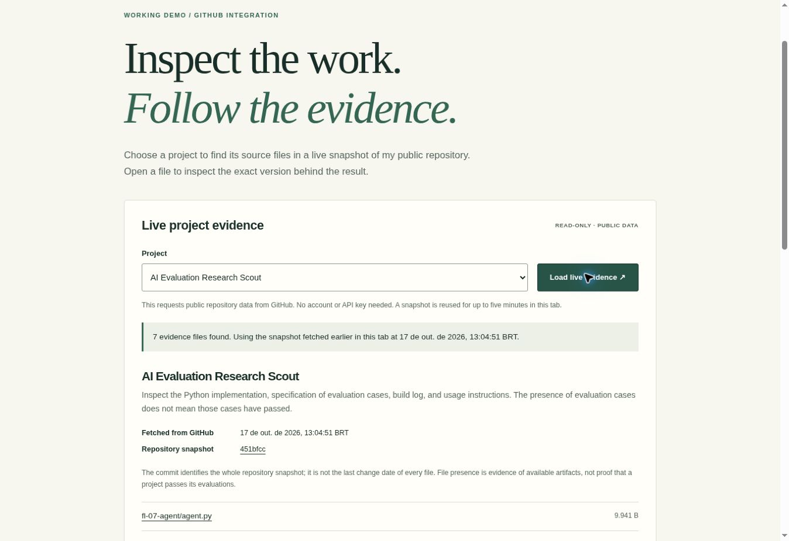

# Make It Do Something — live project evidence

## Deliverable

- Working feature and plain-language explainer: https://eseixas89.github.io/ai-evaluation-portfolio/live-evidence.html
- Portfolio entry point: https://eseixas89.github.io/ai-evaluation-portfolio/
- Implementation: [HTML](live-evidence.html), [CSS](live-evidence.css), [JavaScript](live-evidence.js).

Exactly one dynamic feature lets a visitor choose a portfolio project and retrieve its available evidence files from the GitHub API. It is a working read-only integration, using GitHub Pages and unauthenticated access to a public repository. No paid service, API key, or model inference is used.

## Backend and data flow

A backend runs on a server and responds to requests. Here, GitHub Pages serves the static page, while the GitHub API is the external backend supplying repository data. There is no custom backend application.

After a visitor chooses a project and presses **Load live evidence**, the browser requests the current commit on `main` and then the recursive file tree at that commit's tree SHA. GitHub returns JSON. The JavaScript filters the tree for the selected project, renders file paths and sizes, and constructs links pinned to the same commit. This lets a reviewer inspect the evidence behind a project.

A fresh lookup uses two API requests. The successful snapshot is reused for five minutes in the same tab; no local storage or database is used. Public API requests are subject to GitHub's limits, generally 60 unauthenticated requests per hour per IP. GitHub receives normal request information, including the visitor's IP. The page handles API failures, unavailable repositories, rate limits, malformed or incomplete responses, and timeouts. A direct repository link stays available.

The presence of a file does not establish that its contents are correct or that a project's evaluations have passed. This demo discovers evidence for human inspection.

## Real public-site test

Observed in Chrome on **17 October 2026, 13:04:51 BRT / 16:04:51 UTC**.

- Entered the feature from the new link in the portfolio's first project card.
- Clicked **Load live evidence** on the deployed GitHub Pages page.
- The real GitHub request returned repository snapshot `451bfcc7dbcee61244224bba74ea829f51d4c3a6`.
- Research Scout displayed **7 files**, including `agent.py`, `BUILD_LOG.md`, and `EVALS.md`.
- Switching to the workflow displayed **2 files**, using the same fetched snapshot.
- Switching to connectors displayed **2 files**, using the same fetched snapshot.
- The displayed links included the full snapshot commit SHA.

## Simulated failure and rendering checks

Ten scenarios passed against the actual page script in a jsdom DOM environment. These were simulated responses, separate from the real browser/API test above:

1. Success rendering, pinned links, hidden-file exclusion, all project selections, and cache reuse.
2. HTTP 403 with exhausted rate limit; retry control is restored.
3. HTTP 404.
4. HTTP 500.
5. Network failure.
6. Malformed commit response.
7. Truncated tree response.
8. Request timeout.
9. HTML-like file names remain inert text with encoded URLs.
10. Empty project results.

JavaScript syntax and Git whitespace checks also passed. Desktop visual layout was inspected in the public browser. Mobile CSS is provided but a separate mobile-viewport test has not been recorded.

## Repeat the real test

1. Open the public feature link above.
2. Leave Research Scout selected and click **Load live evidence**.
3. Confirm a fetched timestamp, a snapshot commit, and project file links appear.
4. Choose another project and click again. Within five minutes, the page should indicate it is reusing the earlier snapshot and show that project's files.
5. Open a file link to inspect the version pinned to that commit.

## Submission notes — draft for owner review

> One dynamic feature is live in my portfolio: a project-evidence explorer. Visitors select a project and retrieve its source-file list from GitHub. GitHub Pages hosts the frontend; the GitHub API acts as the external backend. The browser fetches the current commit and its file tree, then displays project files with links pinned to that version. A real test returned seven Research Scout files, and switching projects reused the same snapshot. The page includes the backend/data-flow explanation, and this evidence log records the test. Implementation was prepared with AI assistance.

Before submitting, the portfolio owner should run the demo, read the explanation, and adapt this draft into their own words, as required by the assignment.
